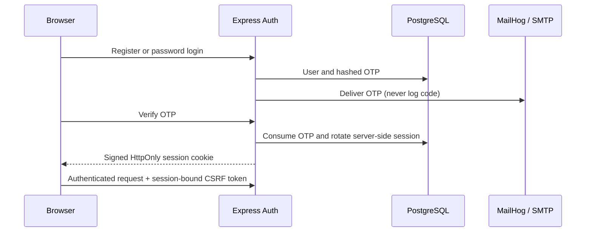

# Architecture

PrivacyLint is a monorepo with a React/Vite client, an Express auth/email service, and a Python/FastAPI analysis service. PostgreSQL is the source of truth for account/session/scan data; Neo4j will store scan-scoped data-flow relationships. Redis is used by later analysis and job-queue phases, with documented in-process fallbacks for local development.

## Phase 1 request flow

## Trust boundaries

- Uploaded source repositories are untrusted data. The analysis service must parse them without executing them.
- The browser receives no provider secret. Gemini, Google OAuth, SMTP, and GitHub credentials belong in server-side environment configuration.
- AI-generated content cannot create or clear a deterministic finding. It can only propose bounded explanatory or patch content, which must pass the sandbox verification gate.
- Audit metadata excludes user-provided values. Auth errors are generic and do not serialize exceptions or request bodies.

## Current limitations

The analysis API currently exposes only health status. The scanner and its integrations are not implemented yet. Auth resend throttling and email delivery queue state are process-local, so multi-replica production deployment needs Redis-backed state and a durable queue.

